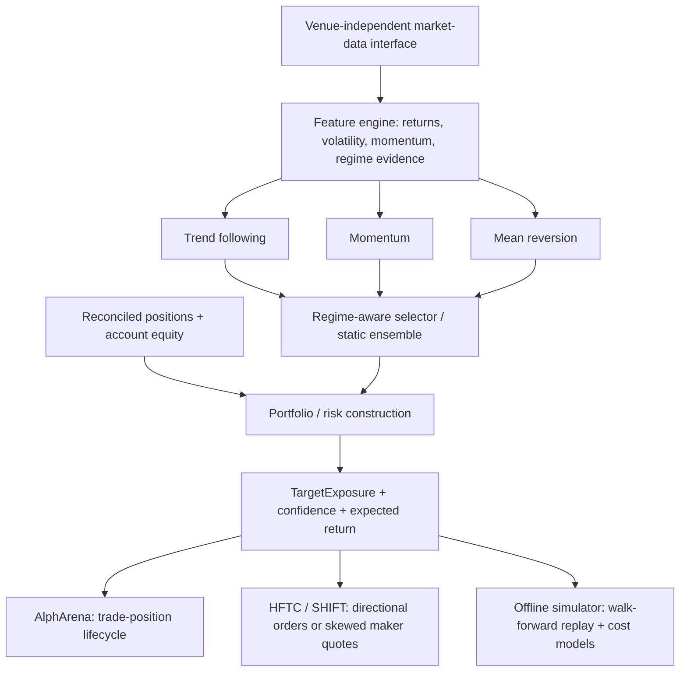

# AlphArena forward-testing pilot — shared alpha-engine direction

Status: architectural direction agreed on 2026-11-09. This note is the implementation handoff for later work. **PR #13 remains an API-boundary-only change.**

## Goal and scope

Use AlphArena as the first **forward-testing adapter** for a venue-independent alpha-generation, regime-aware strategy-selection, and target-exposure framework. The primary experimental environment is an **offline historical/replay simulator**; HFTC/SHIFT is the later execution and order-book validation adapter.

**We are not building an AlphArena-specific strategy bot or treating AlphArena as a market-making venue.** Its API expresses opening, updating, and closing positions, not passive bid/ask quoting, queue position, order-book placement, or cancel/replace. A positive AlphArena paper track record is evidence of directional prediction on its own horizon; it does not establish HFTC/SHIFT fill quality, spread capture, or microstructure edge.

## Separation of concerns



Model decisions and desired portfolio exposures are **not exchange orders**. The execution layer maps the same target into different operations:

- AlphArena: reconcile open/closed positions, then open/close as necessary, subject to API and paper-trading limits. Do not assume partial close or continuous weight rebalancing is available.
- SHIFT directional execution: trade toward target inventory at a horizon and frequency calibrated to SHIFT data.
- SHIFT directional market making: adjust reservation price and bid/ask sizes based on target exposure, inventory risk, spread and fill-risk constraints. Keep the resting-order manager separate from AlphArena's position lifecycle.
- Offline simulator: identical feature and policy implementation, with explicit pricing, costs, latency and fill assumptions.

## Proposed shared contracts (future PR)

```python
from dataclasses import dataclass
from decimal import Decimal

@dataclass(frozen=True)
class TargetExposure:
    symbol: str
    target_weight: Decimal
    expected_return: Decimal
    confidence: Decimal
    regime: str
    strategy: str
```

Further proposed independent types: `FeatureSnapshot`, `AlphaSignal`, `PortfolioSnapshot`, `TradeIntent`, `TradePosition`. Define timestamps, observation horizon, data provenance, decision ID, and versioned strategy/model identity; no float rounding at the venue boundary. An `AlphaSignal` estimates conditional opportunity; `TargetExposure` additionally incorporates position sizing, capital, correlation and constraints.

## Strategies and validation transfer

| Candidate | AlphArena pilot | HFTC transfer |
| --- | --- | --- |
| Trend following | Good | Recalibrate horizon and coefficients |
| Price momentum | Good | Recalibrate horizon and execution costs |
| Mean reversion | Good | Execution and cost-sensitive |
| Regime detection / policy switching | Good decision-level pilot | Transfer decision concept, not fitted thresholds |
| Cross-asset statistical arbitrage | Partial | Requires coordinated execution and hedge constraints |
| Directional market making | Alpha signal only | Translate into inventory targets / quote skew |
| Spread capture, queue dynamics, adverse selection | Not supported | SHIFT or order-book simulator only |

AlphArena is low-frequency position-based paper trading; HFTC/SHIFT is intraday and event/microstructure-driven. Historical AlphArena equity data must come from a separate reproducible source. Columbia's 15-tick directional signal needs event-level HFTC data and the correlation-breakdown strategy needs suitable synthetic scenarios. Do not infer those properties from an AlphArena leaderboard.

## Experiment design and success criteria

1. **Offline strategy tournament:** Use identical aligned observations for trend, momentum, mean reversion, static equal-weight signal ensemble, and regime-aware selector. Train/validate walk-forward with purging/embargo as needed; forbid lookahead, future-dependent normalizations and overlapping-label leakage.
2. **Cost-aware comparison:** Measure after-cost return, drawdown, turnover, Sharpe (with appropriate frequency/annualization), exposure, tail risk, stability across periods and incremental improvement versus the best fixed policy and equal-weight ensemble. Account for switching churn, delays, slippage and market-impact assumptions. Report confidence/uncertainty rather than claiming generalization from a single split.
3. **AlphArena forward test:** Start small under free-tier and portfolio limits; log feature snapshot, regime, policy scores, selected target, expected edge, risk checks, submitted intent, venue acknowledgement, and realized outcomes. Reconcile local state with authoritative venue reads and measure forecast-vs-paper divergence.
4. **SHIFT integration:** Reuse feature and policy interfaces, retrain/recalibrate using SHIFT event data, and separately validate latency, fill probability, inventory management, P&L accounting and competition scoring.

**Main hypothesis:** A regime-aware selector improves *out-of-sample risk-adjusted returns after realistic costs*, beyond both the best fixed individual strategy and a simple static ensemble. Treat failure of that hypothesis as a useful result, not an invitation to overfit.

## Interface / delivery plan

- **P0 — PR #13:** `exchanges/alpharena/` synchronous HTTP API boundary, exact Decimal serialization, authentication, typed errors, bounded timeouts and offline contract tests. No scheduled trades, alpha engine or portfolio reconciler. Merge this before subsequent alpha implementation.
- **P1 — Shared alpha domain:** `AlphaSignal`, `FeatureSnapshot`, `TargetExposure` and strategy interface, with time/horizon provenance.
- **P2 — Feature/policy layer:** common features, individual policies and regime-aware selector.
- **P3 — Offline evaluation:** walk-forward harness, cost modeling, fixed-policy and ensemble baselines.
- **P4 — Position lifecycle:** persistent intents, risk constraints, idempotency/recovery, account/position reconciliation, explicit dry-run mode.
- **P5 — AlphArena forward testing:** scheduled runner, external data feed, limited sandbox validation, then explicitly authorized leaderboard paper trading.
- **P6 — SHIFT:** directional and market-making target translation, venue-specific risk/execution studies.

## Operational guardrails

- Never send unintended trades or create an agent during development. All initial contract tests are offline with mocked transport.
- Persist a stable decision ID and idempotency key **before** opening a position. Never assume retries of PATCH/close are idempotent; reconcile an uncertain result before acting.
- Keep paper credentials out of the repository and logs. Sandbox (`aa_test_`) and leaderboard (`aa_live_`) are different explicitly selected modes; leaderboard is still simulated.
- As documented on 2026-11-09: free tier: 10 signals/day, up to 60 API requests/minute, one strategy designation, 25% maximum position size per trade (verify terms/docs again before production). Do not hard-code paid limits without re-verification.
- Stock entry price is a *reference*, not a limit price. Platform market data determines fill; option entry premiums are agent-supplied, so options P&L is not independently validated.
- Separate market data, signals, portfolio targets, venue requests and venue-confirmed state in all journals and metrics.

## Acceptance criteria for PR #13

The API client supports authenticated own-trade/portfolio operations, public agent/benchmark reads as needed, exact Decimal JSON roundtrip, predictable API/transport/HTTP error classifications, safe timeouts and explicit uncertain-write recovery requirements. No embedded alpha logic, hidden retries, automatic submissions or other venue integrations. Confirm suite and CI before merge; sandbox live integration remains a separately authorized later step.

References: https://alpharena.io/docs and https://alpharena.io/terms (reviewed 2026-11-09).
