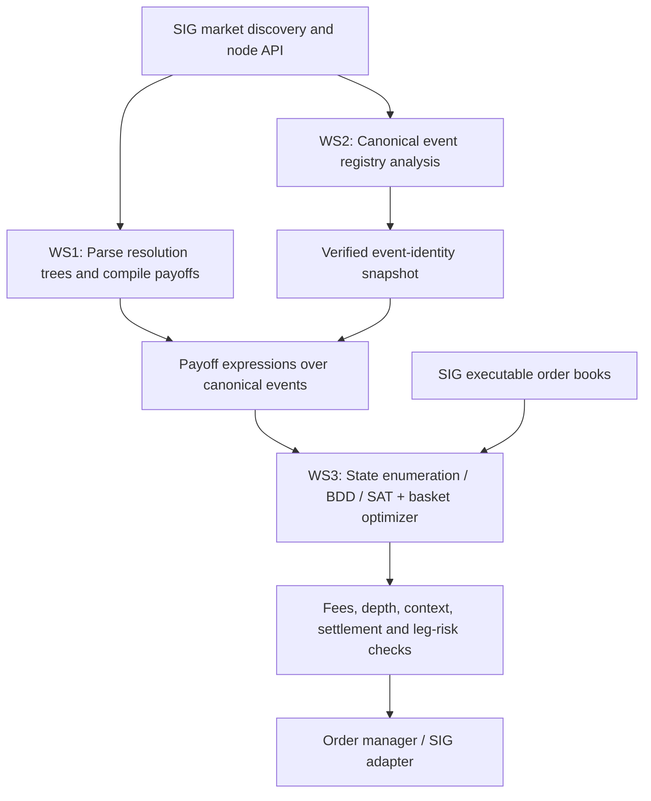

# SIG Predictions: Canonical Event Registry and Logical Arbitrage Workstreams

> **Status:** Research and architecture proposal; not yet an implemented or empirically verified trading strategy.  
> **Scope:** Separate cross-market event identity analysis from Boolean payoff compilation and arbitrage optimization.  
> **API reference:** [SIG Predictions data model](./SIG_PREDICTIONS_DATA_MODEL.md), based on `sig-predictions-open-api.json`.

## 1. Objective

Build a **deterministic, auditable logical-arbitrage pipeline** for SIG prediction markets. Use structured MarketNode resolution trees where possible, rather than relying on an LLM to interpret the logical operators.

The critical boundary is:

- A **MarketNode tree** defines a market's logical resolution rule; parsing it does **not** require an LLM.
- A **Contract leaf** identifies an atomic condition, but a contract ID / node ID is not necessarily a globally canonical event identity.
- A **canonical event registry** establishes when conditions referenced from *different* markets represent the same settlement event.
- An **arbitrage engine** consumes verified event identities and payoff expressions; it must not discover or assume semantic equivalence on its own.

The registry is a **separate analysis/research workstream**, not part of the hot-path market-maker, the execution adapter, or the pricing engine. It may run offline or asynchronously and publish a versioned, verified snapshot.

## 2. Three independent workstreams

| Workstream | Responsibility | Primary output | Depends on |
| --- | --- | --- | --- |
| **WS1 — Market structure and payoff compiler** | Parse MarketNodes, validate operator semantics, compile each tradeable outcome's payoff into Boolean logic | Typed AST / canonical Boolean expression per tradeable payoff | SIG node data and a confirmed market-to-exchange payoff mapping |
| **WS2 — Canonical event identity analysis** | Analyze leaf specifications across markets; establish exactly which conditions are equivalent or have a proven implication | Versioned canonical-event registry with evidence and provenance | SIG Contract metadata, source references, settlement specifications |
| **WS3 — Arbitrage analysis and execution** | Combine payoff expressions using verified cross-market relationships; search for state-independent profitable baskets at executable prices | Feasible trade baskets, payoff certificates, execution/risk decisions | WS1, WS2, live books, venue/risk capabilities |

WS1 and the WS3 solver can be built **before WS2** using synthetic or explicitly verified shared-event mappings. WS2 can be researched and validated independently, then integrated as an input.

### Data flow



**Design invariant:** no tentative identity match can silently enter the certified-arbitrage payoff model.

## 3. WS1 — Market structure and payoff compiler

### Inputs

- Market's resolution tree from `GET /markets/{id}/nodes`.
- `operator` nodes and child relationships; `contract` leaves and their local IDs.
- Market and Exchange metadata identifying the *specific traded payout* represented by the expression.

### Output

A typed expression over **event references**, for example:

```text
Market M1  -> A
Market M2  -> B
Market M3  -> AND(A, B)
```

A and B begin as **market-local event symbols** unless WS2 establishes cross-market equivalence. Do not merge event variables merely because their titles resemble one another.

### Rules

1. Parse the MarketNode tree as a deterministic Boolean AST.
2. Implement `AND`, `OR`, and `NOT` with tested truth tables. The spec also lists `IF`; **confirm its exact semantics** before supporting it.
3. Normalize commutative operations (e.g., sort children of `AND` and `OR`) without changing their truth values; avoid unproven rewrites.
4. Associate the expression with its *tradable Exchange and settlement option* **only when that mapping is established by the API**. Do not assume one leaf equals one Exchange, that `contract_id == exchangeId`, or that a multi-outcome market's root Boolean result is the payoff of every Exchange.
5. Compile and validate small expressions with exhaustive truth tables; handle repeated event symbols correctly.

**WS1 deliverable:** a library that emits a verified Boolean payoff expression or an explicit `unsupported / ambiguous` result.

## 4. WS2 — Canonical event registry (standalone analysis)

### Research question

**Can we reliably identify when two Contract leaves, possibly belonging to different markets, describe the exact same settlement event?**

A positive answer requires *settlement equivalence*, not title similarity or statistically high correlation.

### Discovery and normalization pipeline

1. Inventory markets, their root nodes, leaf nodes, `contractType`, `contractDetails`, settlement dates, settlement options, and relevant identifiers.
2. Identify explicit references, including `Existing Market` details such as `marketId`, `exchangeId`, and `settlementOption`, and verify what relationship those references actually establish.
3. Extract a **typed, normalized condition** where supported: underlying identifier, operator, threshold, measurement source, observation window/time zone, settlement reference, outcome polarity, and other contract-specific fields.
4. Generate equivalence **candidates** using explicit links or strict structured comparisons. Keep freeform contracts separate unless rules can be verified.
5. Verify identical resolution and payout semantics, including exact boundaries (`>` vs `>=`), timing, official data source, revisions, void/cancellation rules, and context-specific settlement behavior.
6. Publish immutable/versioned event identities, evidence, and the individual source leaves mapped to each identity.
7. Revalidate on market updates and settlement-rule changes; never mutate verified mappings without a recorded reason/version.

The initially useful outcome is a **coverage report** showing how many events are linkable through explicit references and exact structured metadata, and what proportion remain ambiguous.

### Evidence levels

| Level | Meaning | Admissible for certified logical arbitrage? |
| --- | --- | --- |
| **Verified** | Exact settlement identity established with sufficient evidence; documented provenance | **Yes** |
| **Candidate** | Similar structured fields, names or inferred semantics, but an unresolved difference remains | **No** |
| **Rejected / distinct** | Known differences in settlement event, oracle, threshold, date, or rules | **No** |
| **Unknown** | Insufficient information to compare | **No** |

An LLM is **not a required dependency**. If used later, it may **propose candidates** or flag ambiguities, but cannot promote a pair to verified without deterministic evidence or explicit human review.

### Proposed record shape (internal model, not SIG API schema)

```json
{
  "canonical_event_id": "evt:example:btc-threshold-2030",
  "version": 1,
  "status": "verified",
  "normalized_condition": {
    "underlying": "BTC",
    "comparison": ">",
    "threshold": "100000",
    "observation_time": "2030-12-31T23:59:59Z",
    "settlement_source": "SOURCE_TO_BE_VERIFIED"
  },
  "members": [
    {"market_id": "M1", "node_id": "N1"},
    {"market_id": "M3", "node_id": "N9"}
  ],
  "evidence": [
    {"kind": "validated_contract_rules", "reference": "SOURCE_TO_BE_VERIFIED"}
  ]
}
```

The record is **illustrative**; fields vary by contract type. IDs and source names above are placeholders, not real SIG records.

### Boundary conditions and invariants

- Same text is **not** proof of equivalent settlement.
- Same market theme, correlated underlyings, or similar predicted probabilities are **not** event identity.
- A `contract_id` being equal to its local `node_id` does **not** make it a universal event key or an Exchange ID.
- `Existing Market` references provide strong structural evidence but still require exact interpretation of the referred settlement option.
- A `NOT(A)` event is **logically related to**, but not **identical to**, `A`. Model complement and implication relationships separately from identity.
- Multiple tournaments may have isolated trading and settlement contexts; only combine contracts into guaranteed baskets if their payout obligations can actually be compared/settled as assumed.
- Do not conflate contracts that have different settlement dates, data sources, threshold inclusivity, or treatment of exceptional outcomes.

### WS2 acceptance criteria

- Reproducible extraction from a fixed API snapshot or fixture set.
- Strict parser/canonicalizer for at least one structured `contractType`.
- Provenance for every verified match; deterministic reruns produce stable identities.
- Negative test fixtures for same-title/different-date, boundary mismatch, mismatched oracle, and positive/negative outcome polarity.
- Coverage report: total leaves, exact/explicit matches, verified groups, unresolved candidates, conflicts.
- Exported, versioned registry consumed read-only by WS1/WS3.

## 5. WS3 — Logical arbitrage engine

### Payoff constraints, not estimated probabilities

Given coherent settlement semantics, a Boolean payoff for each tradable leg can be evaluated over feasible event states `s`. A basket with quantities `q_i`, costs `c_i`, and payoffs `g_i(s)` has state-dependent net P&L:

```text
PnL(s) = sum_i q_i * g_i(s) - sum_i q_i * c_i - fees
```

A **certified gross payoff floor** follows from minimizing over **every feasible state**. Claim a guaranteed *net* arbitrage only when:

```text
min_s PnL(s) > 0
```

with real executable prices, sizes, fees, capital/collateral constraints, compatible settlement obligations, and final inventory considered.

Example: if `C = A AND B`, then `C => A`. Buying one YES(A) and one NO(C) pays at least one unit in every Boolean state. If the two executable asks total less than one, this creates a **conditional gross arbitrage opportunity**. Whether it can be realized depends on matched fill sizes, execution, settlement and costs.

### Solver boundary

- Consume **certified** Boolean payoff expressions and verified cross-market mappings.
- Enumerate feasible truth assignments for small event sets; consider BDD/SAT for larger sets and LP/MILP for portfolio selection with quantities and liquidity constraints.
- Include YES/NO order-side semantics, all relevant book levels, venue tick size, lot size, fees, and rounding.
- Mark a priced opportunity as **theoretical** until execution risk has been handled.
- Do **not** assume multi-leg order submission guarantees simultaneous fills or that two separately resting orders are an atomic basket.
- Keep the SIG adapter responsible for exact `exchangeId`, context/`tournamentId`, and order mechanics. The solver works on abstract payoff legs.

## 6. Implementation sequence and checkpoints

| Phase | Workstream | Minimum result | Exit criterion |
| --- | --- | --- | --- |
| **P0** | WS1 + WS3 | Boolean AST, truth-table tests, payoff-matrix generator, synthetic arbitrage examples | Finds true arbitrages and rejects false ones over exhaustive small-state fixtures |
| **P1** | WS2 research | Inventory real SIG leaf types, ID/reference behavior, cross-market linkage coverage | Written findings with verified/unknown mapping categories and dataset examples |
| **P2** | WS2 implementation | Canonicalizer and read-only versioned registry for one or more safe structured cases | Zero false-positive equivalence on curated negative tests |
| **P3** | WS1 + WS2 integration | Compile real exchange payoffs using verified event identities | Every generated mapping has traceable evidence; unsupported cases skipped |
| **P4** | WS3 paper trading | Executable-depth opportunity scan and simulated basket execution | Measured gross/net edge, fill-risk exposure, opportunity frequency and latency |
| **P5** | Controlled live/tournament trading | Risk-limited execution and reconciliation | Demonstrated fill, position and settlement correctness before scaling |

Develop P0 while researching P1; they are independent. Registry coverage is a primary gating metric: if few markets share provably identical events, logical arbitrage opportunities may be too sparse to justify full automation.

## 7. Questions for the SIG API reconnaissance exercise

These are **open questions**, not established API guarantees:

1. Are leaf Contract IDs stable and reusable across distinct Markets, or always local to their trees?
2. Do `Existing Market` references resolve to enough data to prove event/option equivalence?
3. What exact data types and normalization rules exist for each `contractType`?
4. How does a multi-outcome MarketNode tree map to each Exchange's YES payout condition?
5. What is the exact `IF` operator semantics?
6. Can otherwise equivalent markets settle differently across public/tournament contexts?
7. How often are semantically identical events repeated across markets, and at what executable liquidity?
8. What basket execution guarantees and order-state reconciliation mechanisms does SIG actually offer?

**Do not fill unknowns with assumed semantics.** Mark unsupported markets as such, and distinguish an *API-observed fact* from an *analysis hypothesis* in every research result.

## 8. Research deliverables and interfaces

Suggested artifacts:

```text
SIG market snapshot + metadata
    -> WS2 event inventory
    -> canonical_event_registry.json (versioned, verified-only)
    -> candidate_matches.json (analysis-only; never fed into certified solver)

MarketNode data
    -> WS1 exchange_payoffs.json (typed Boolean ASTs, mapping evidence)

WS1 payoffs + WS2 verified registry + market books
    -> WS3 arbitrage_candidates.json (payoff-floor certificate, cost/depth/risk)
```

Use a versioned, immutable registry reference in backtests and paper-trading runs, so any resulting trade decision can be audited against the precise identity assumptions in force.

**Strategic separation:** WS2 establishes *what events are the same*; WS1 establishes *what each instrument pays*; WS3 establishes *whether a feasible basket makes money*. None of these steps inherently requires an LLM or a fundamental event-probability forecast.
