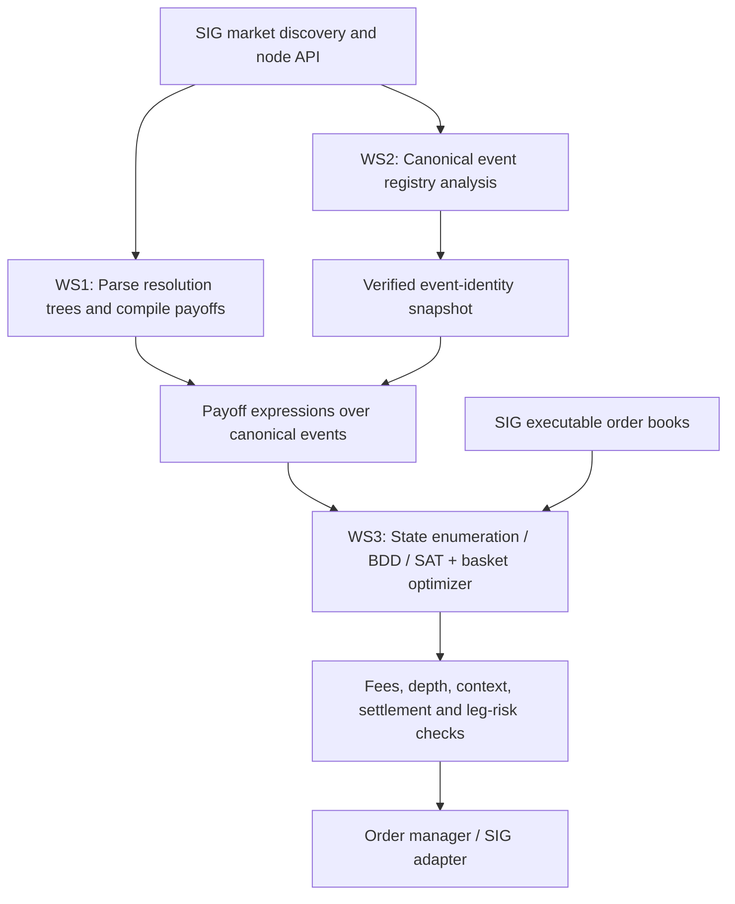

# SIG Predictions: Canonical Event Registry and Logical Arbitrage Workstreams

> **Status:** Research and architecture proposal; not yet an implemented or empirically verified trading strategy.  
> **Scope:** Separate cross-market event identity analysis from Boolean payoff compilation and arbitrage optimization.  
> **API reference:** [SIG Predictions data model](./SIG_PREDICTIONS_DATA_MODEL.md), based on `sig-predictions-open-api.json`.

## 1. Objective

Build a **deterministic, auditable logical-arbitrage pipeline** for SIG prediction markets. Use structured MarketNode resolution trees where possible, rather than relying on an LLM to interpret the logical operators.

The critical boundary is:

- A **MarketNode tree** defines a market's logical resolution rule; parsing it does **not** require an LLM.
- A **Contract leaf** identifies an atomic condition, but a contract ID / node ID is not necessarily a globally canonical event identity.
- A **canonical event registry** establishes when conditions referenced from *different* markets represent the same settlement event.
- An **arbitrage engine** consumes verified event identities and payoff expressions; it must not discover or assume semantic equivalence on its own.

The registry is a **separate analysis/research workstream**, not part of the hot-path market-maker, the execution adapter, or the pricing engine. It may run offline or asynchronously and publish a versioned, verified snapshot.

## 2. Three independent workstreams

| Workstream | Responsibility | Primary output | Depends on |
| --- | --- | --- | --- |
| **WS1 — Market structure and payoff compiler** | Parse MarketNodes, validate operator semantics, compile each tradeable outcome's payoff into Boolean logic | Typed AST / canonical Boolean expression per tradeable payoff | SIG node data and a confirmed market-to-exchange payoff mapping |
| **WS2 — Canonical event identity analysis** | Analyze leaf specifications across markets; establish exactly which conditions are equivalent or have a proven implication | Versioned canonical-event registry with evidence and provenance | SIG Contract metadata, source references, settlement specifications |
| **WS3 — Arbitrage analysis and execution** | Combine payoff expressions using verified cross-market relationships; search for state-independent profitable baskets at executable prices | Feasible trade baskets, payoff certificates, execution/risk decisions | WS1, WS2, live books, venue/risk capabilities |

WS1 and the WS3 solver can be built **before WS2** using synthetic or explicitly verified shared-event mappings. WS2 can be researched and validated independently, then integrated as an input.

### Data flow



**Design invariant:** no tentative identity match can silently enter the certified-arbitrage payoff model.

## 3. WS1 — Market structure and payoff compiler

### Inputs

- Market's resolution tree from `GET /markets/{id}/nodes`.
- `operator` nodes and child relationships; `contract` leaves and their local IDs.
- Market and Exchange metadata identifying the *specific traded payout* represented by the expression.

### Output

A typed expression over **event references**, for example:

```text
Market M1  -> A
Market M2  -> B
Market M3  -> AND(A, B)
```

A and B begin as **market-local event symbols** unless WS2 establishes cross-market equivalence. Do not merge event variables merely because their titles resemble one another.

### Rules

1. Parse the MarketNode tree as a deterministic Boolean AST.
2. Implement `AND`, `OR`, and `NOT` with tested truth tables. The spec also lists `IF`; **confirm its exact semantics** before supporting it.
3. Normalize commutative operations (e.g., sort children of `AND` and `OR`) without changing their truth values; avoid unproven rewrites.
4. Associate the expression with its *tradable Exchange and settlement option* **only when that mapping is established by the API**. Do not assume one leaf equals one Exchange, that `contract_id == exchangeId`, or that a multi-outcome market's root Boolean result is the payoff of every Exchange.
5. Compile and validate small expressions with exhaustive truth tables; handle repeated event symbols correctly.

**WS1 deliverable:** a library that emits a verified Boolean payoff expression or an explicit `unsupported / ambiguous` result.

## 4. WS2 — Canonical event registry (standalone analysis)

### Research question

**Can we reliably identify when two Contract leaves, possibly belonging to different markets, describe the exact same settlement event?**

A positive answer requires *settlement equivalence*, not title similarity or statistically high correlation.

### Discovery and normalization pipeline

1. Inventory markets, their root nodes, leaf nodes, `contractType`, `contractDetails`, settlement dates, settlement options, and relevant identifiers.
2. Identify explicit references, including `Existing Market` details such as `marketId`, `exchangeId`, and `settlementOption`, and verify what relationship those references actually establish.
3. Extract a **typed, normalized condition** where supported: underlying identifier, operator, threshold, measurement source, observation window/time zone, settlement reference, outcome polarity, and other contract-specific fields.
4. Generate equivalence **candidates** using explicit links or strict structured comparisons. Keep freeform contracts separate unless rules can be verified.
5. Verify identical resolution and payout semantics, including exact boundaries (`>` vs `>=`), timing, official data source, revisions, void/cancellation rules, and context-specific settlement behavior.
6. Publish immutable/versioned event identities, evidence, and the individual source leaves mapped to each identity.
7. Revalidate on market updates and settlement-rule changes; never mutate verified mappings without a recorded reason/version.

The initially useful outcome is a **coverage report** showing how many events are linkable through explicit references and exact structured metadata, and what proportion remain ambiguous.

### Evidence levels

| Level | Meaning | Admissible for certified logical arbitrage? |
| --- | --- | --- |
| **Verified** | Exact settlement identity established with sufficient evidence; documented provenance | **Yes** |
| **Candidate** | Similar structured fields, names or inferred semantics, but an unresolved difference remains | **No** |
| **Rejected / distinct** | Known differences in settlement event, oracle, threshold, date, or rules | **No** |
| **Unknown** | Insufficient information to compare | **No** |

An LLM is **not a required dependency**. If used later, it may **propose candidates** or flag ambiguities, but cannot promote a pair to verified without deterministic evidence or explicit human review.

### Proposed record shape (internal model, not SIG API schema)

```json
{
  "canonical_event_id": "evt:example:btc-threshold-2030",
  "version": 1,
  "status": "verified",
  "normalized_condition": {
    "underlying": "BTC",
    "comparison": ">",
    "threshold": "100000",
    "observation_time": "2030-12-31T23:59:59Z",
    "settlement_source": "SOURCE_TO_BE_VERIFIED"
  },
  "members": [
    {"market_id": "M1", "node_id": "N1"},
    {"market_id": "M3", "node_id": "N9"}
  ],
  "evidence": [
    {"kind": "validated_contract_rules", "reference": "SOURCE_TO_BE_VERIFIED"}
  ]
}
```

The record is **illustrative**; fields vary by contract type. IDs and source names above are placeholders, not real SIG records.

### Boundary conditions and invariants

- Same text is **not** proof of equivalent settlement.
- Same market theme, correlated underlyings, or similar predicted probabilities are **not** event identity.
- A `contract_id` being equal to its local `node_id` does **not** make it a universal event key or an Exchange ID.
- `Existing Market` references provide strong structural evidence but still require exact interpretation of the referred settlement option.
- A `NOT(A)` event is **logically related to**, but not **identical to**, `A`. Model complement and implication relationships separately from identity.
- Multiple tournaments may have isolated trading and settlement contexts; only combine contracts into guaranteed baskets if their payout obligations can actually be compared/settled as assumed.
- Do not conflate contracts that have different settlement dates, data sources, threshold inclusivity, or treatment of exceptional outcomes.

### WS2 acceptance criteria

- Reproducible extraction from a fixed API snapshot or fixture set.
- Strict parser/canonicalizer for at least one structured `contractType`.
- Provenance for every verified match; deterministic reruns produce stable identities.
- Negative test fixtures for same-title/different-date, boundary mismatch, mismatched oracle, and positive/negative outcome polarity.
- Coverage report: total leaves, exact/explicit matches, verified groups, unresolved candidates, conflicts.
- Exported, versioned registry consumed read-only by WS1/WS3.

## 5. WS3 — Logical arbitrage engine

### Payoff constraints, not estimated probabilities

Given coherent settlement semantics, a Boolean payoff for each tradable leg can be evaluated over feasible event states `s`. A basket with quantities `q_i`, costs `c_i`, and payoffs `g_i(s)` has state-dependent net P&L:

```text
PnL(s) = sum_i q_i * g_i(s) - sum_i q_i * c_i - fees
```

A **certified gross payoff floor** follows from minimizing over **every feasible state**. Claim a guaranteed *net* arbitrage only when:

```text
min_s PnL(s) > 0
```

with real executable prices, sizes, fees, capital/collateral constraints, compatible settlement obligations, and final inventory considered.

Example: if `C = A AND B`, then `C => A`. Buying one YES(A) and one NO(C) pays at least one unit in every Boolean state. If the two executable asks total less than one, this creates a **conditional gross arbitrage opportunity**. Whether it can be realized depends on matched fill sizes, execution, settlement and costs.

### Solver boundary

- Consume **certified** Boolean payoff expressions and verified cross-market mappings.
- Enumerate feasible truth assignments for small event sets; consider BDD/SAT for larger sets and LP/MILP for portfolio selection with quantities and liquidity constraints.
- Include YES/NO order-side semantics, all relevant book levels, venue tick size, lot size, fees, and rounding.
- Mark a priced opportunity as **theoretical** until execution risk has been handled.
- Do **not** assume multi-leg order submission guarantees simultaneous fills or that two separately resting orders are an atomic basket.
- Keep the SIG adapter responsible for exact `exchangeId`, context/`tournamentId`, and order mechanics. The solver works on abstract payoff legs.

## 6. Implementation sequence and checkpoints

| Phase | Workstream | Minimum result | Exit criterion |
| --- | --- | --- | --- |
| **P0** | WS1 + WS3 | Boolean AST, truth-table tests, payoff-matrix generator, synthetic arbitrage examples | Finds true arbitrages and rejects false ones over exhaustive small-state fixtures |
| **P1** | WS2 research | Inventory real SIG leaf types, ID/reference behavior, cross-market linkage coverage | Written findings with verified/unknown mapping categories and dataset examples |
| **P2** | WS2 implementation | Canonicalizer and read-only versioned registry for one or more safe structured cases | Zero false-positive equivalence on curated negative tests |
| **P3** | WS1 + WS2 integration | Compile real exchange payoffs using verified event identities | Every generated mapping has traceable evidence; unsupported cases skipped |
| **P4** | WS3 paper trading | Executable-depth opportunity scan and simulated basket execution | Measured gross/net edge, fill-risk exposure, opportunity frequency and latency |
| **P5** | Controlled live/tournament trading | Risk-limited execution and reconciliation | Demonstrated fill, position and settlement correctness before scaling |

Develop P0 while researching P1; they are independent. Registry coverage is a primary gating metric: if few markets share provably identical events, logical arbitrage opportunities may be too sparse to justify full automation.

## 7. Logical-arbitrage research workstream: hypotheses and investigation plan

**Status: unanswered research questions, not demonstrated opportunities.** The API schema supports some of the fields and mechanisms below, but does not establish the prevalence of related markets, whether mixed settlement schedules are accepted, or whether executable arbitrage is available in our tournament. Record **observed fact vs documentation claim vs inference** for every finding.

### 7.1 First-priority questions (P0: determine whether this strategy is viable)

| ID | Investigation question | Why it matters / evidence to collect |
| --- | --- | --- |
| **Q01 — Different leaf settlement dates** | **Can atomic Contract leaves of one composite Market have different settlement dates?** If yes, does the root resolve only after the last leaf, when logically determined early, or under some other rule? | `MarketNode.settlementDate` is per-leaf (usually required on creation, with documented exceptions), and read nodes expose `settlement_date`. **This does not prove that the server permits heterogeneous dates in one accepted tree.** Look for actual mixed-date market trees; capture the parent `Market.settlementDate` and observed lifecycle. Ask SIG or validate safely if the behavior remains ambiguous. |
| **Q02 — Prevalence of exploitable relationships** | **What fraction of accessible markets and Exchanges participates in a *verified logical relationship* with another tradable instrument?** | Inventory the **actual tournament market universe**. Count verified equivalence, complement, implication, conjunction/disjunction, mutual-exclusion and exhaustive-partition relations **separately**. Report denominators, coverage, relation types and confidence; do not use merely similar titles as matches. |
| **Q03 — Actual arbitrage incidence** | Among logically related markets, **what fraction ever exhibits a positive-net, executable basket at real order-book depth?** | Separate relationship coverage from monetizable opportunity. Sample synchronized snapshots over time; calculate basket size, executable cost, fees, capital lockup, conservative profit floor and order expiry. Report frequency, persistence and achievable notional. |
| **Q04 — Exchange-to-payoff mapping** | Can we determine each individual Exchange's **exact YES payout condition**, including multi-outcome and composite markets, from the returned nodes and market metadata? | The root tree alone may not identify the settlement option of each Exchange. Establish mapping with API evidence or actual examples; mark unsupported mappings rather than assuming one leaf = one Exchange. |
| **Q05 — Cross-market event identifiers** | Do different Markets reuse the same atomic event or Contract identifier? How frequently do `Existing Market` references provide verifiable shared identity? | Measure explicit structural links before implementing approximate event matching. Test whether `contract_id` / `node_id` is local to a tree, and how referenced `exchangeId` and `settlementOption` determine the exact event. |
| **Q06 — Execution feasibility** | Can we place every arbitrage leg in one **fill-atomic** basket in our tournament, at our prices and sizes? | The spec describes `POST /orders/multi-leg` with up to **10 legs**. Default mode atomically places orders but permits individual partial fills/resting. `executionMode: "allOrNone"` is documented as all-legs-filled-or-none **only when all legs are engine-routed**. Determine our route's eligibility, depth, size limits and actual rejection behavior; do not equate atomic submission with atomic execution. |
| **Q07 — Settlement and context compatibility** | Do the related legs settle against the **same authoritative event, rules, currency and trading context**? Can public and tournament outcomes diverge? | Markets can expose context-specific settlement. Evaluate baskets within the same economically compatible scope; verify rules for cancellations, voids, disputes, differing resolution decisions, collateral and payout denominations. |
| **Q08 — Enough real opportunities?** | Is the measured *opportunity count × feasible size × conservative net edge* large enough to justify building the production solver? | Build a go/no-go assessment from observed data rather than assuming logical consistency violations are common. Compare projected opportunity value with engineering and operating costs. |

### 7.2 Temporal and settlement semantics (P0–P1)

These questions matter even when event identity and Boolean logic are correct: payout equivalence is not the same as cash-flow equivalence at different dates.

| ID | Question / falsification case |
| --- | --- |
| **Q09** | If Contract A settles before Contract B, does an `AND(A,B)` market close, suspend trading, settle partially, or wait? Can an `OR` market settle early once one leaf becomes true? |
| **Q10** | Is a leaf's `settlementDate` the **observation date**, the last possible occurrence date, the expected settlement processing time, or something else? What is the interpretation when it is null? |
| **Q11** | Do we observe markets with an identical threshold and source but **different observation times**? Which implication rules are actually valid? E.g. “BTC above $100k **by** December” is generally not the same event as “BTC above $100k **on** December”; an implication across dates requires verified temporal/monotonic semantics. |
| **Q12** | Can a composite market combine already-settled and unsettled leaves? Are already-settled outcomes visible and immutable within a tournament? |
| **Q13** | Can an unresolved dispute, cancellation, early termination, or missing oracle observation make a theoretically certain basket have nonstandard payout, delayed payout, or no payout? |
| **Q14** | If hedged legs mature at different times, how much collateral and capital remains locked, and is the theoretical profit still positive after funding/discounting and liquidity constraints? |

**Suggested test:** record each composite tree's leaf `settlement_date` values, their number of distinct non-null dates, parent `Market.settlementDate`, current root/leaf settlement state and observation time. Stratify single-date, mixed-date, missing-date, and `Imported Market` / monitored `Corporate Earnings` cases. Inspect actual examples before deciding execution policy.

### 7.3 Nature and density of market relationships (P0–P1)

| ID | Investigation question | Test / possible outcome |
| --- | --- | --- |
| **Q15 — Identity vs implication** | Besides identical events, how often can we prove **non-identity logical relations** (e.g., same underlying/date/oracle with thresholds `X > 90` implying `X > 80`)? | Registry must eventually export a **verified relation graph**, not just equivalence classes. Prove directionality and inclusivity; retain source-level evidence. |
| **Q16 — Exclusivity** | Which multi-outcome markets form exactly one exhaustive partition, which are mutually exclusive but non-exhaustive, and which have independently settling options? | Count only **verified** partitions for sum-to-one/arbitrage checks; the API explicitly allows multi-outcome options that are not mutually exclusive. |
| **Q17 — Logical overlap** | Do unrelated-looking composite markets share atomic conditions, and are the structures deep/rich enough to yield useful cross-market constraints? | Collect AST sizes, distinct canonical events per root, operator counts, shared leaf counts and graph connected-component sizes. |
| **Q18 — Disjoint vs overlapping contexts** | How much apparent global-market overlap survives after limiting each comparison to the same accessible SIG tournament and tradable currency? | Report overlap within each `tournamentId`, **not** by mixing cross-context books or capital. |
| **Q19 — Type/category concentration** | Are linkable events concentrated in particular `contractType` / category combinations (Financial Product, Economic Indicator, Election Outcome, etc.)? | Group by category and structured-data completeness; prioritize deterministic normalization where it yields the most connections. |
| **Q20 — Statistical correlation** | Separately, which markets have significantly correlated traded prices or common underlying factors? Does this add candidates beyond provable logic? | Use histories/quotes only when available and aligned; distinguish liquidity-driven co-movement from underlying event dependence. **Correlation is a relative-value research lead, not certified risk-free arbitrage.** |
| **Q21 — Event identity stability** | How often do market updates or changes to contract details invalidate a previously verified identity or implication? | Track version drift and revocation rate; ensure the registry publishes immutable snapshots and records invalidations. |

### 7.4 Economic viability, pricing data and execution (P0–P1)

| ID | Investigation question | Test / possible outcome |
| --- | --- | --- |
| **Q22** | Are sufficient quote depth and size present simultaneously on every leg, or does an apparent edge exist only at stale mid/last-trade prices? | Use actual executable YES/NO bids/asks and depth, *not* `latestPrice` or implied midpoint. |
| **Q23** | How do fees, ticks, lot sizes, partial inventory, collateral, credit limits and order constraints change guaranteed net profit? | Full P&L certificate at realistic matched quantities with consistent NO/YES price normalization. |
| **Q24** | How long do apparent violations persist relative to websocket batching, discovery latency and basket placement? | Repeated market-data snapshots, event timestamps, staleness checks, quote-revision and rejection rates. |
| **Q25** | What happens when `allOrNone` is unavailable or basket size exceeds 10 legs? Is leg risk acceptably hedgeable? | Feasibility classification: fill-atomic, non-atomic with bounded leg risk, or untradeable. Do not certify net arbitrage from a basket that cannot be executed as assumed. |
| **Q26** | Do different markets have payout ratios other than unit YES/NO, context-specific settlement currencies, or special settlement treatments? | Verify economic payoff per share; do not extrapolate Boolean payoff alone to a guaranteed cash payoff. |
| **Q27** | Is apparent arbitrage a single isolated trade, or a repeatable phenomenon after queue priority, competing bots, impact and replenishment? | Measure realized fill rates, net realized P&L and slippage in permitted sandbox/paper tests before live deployment. |
| **Q28** | Can relationships involve over 10 legs or large event sets, and which pruning/BDD/SAT/LP approach remains tractable? | Measure solver time, memory and candidate volume; split components by independently verifiable relation clusters. |

### 7.5 Market-overlap and opportunity measurement protocol

**Do not answer Q02/Q03 with guessed percentages.** First establish an observable and reproducible market universe.

1. **Universe / sample definition.** Snapshot all discoverable markets via paginated `GET /markets` for the target `tournamentId` and a clearly stated timestamp/window. Record total markets, Exchanges, open/closed states, categories, `isComposite`, `isMultiOutcome`, and availability of readable node trees. Document API visibility restrictions and partial coverage.
2. **Extract settlement trees.** Fetch `GET /markets/{id}/nodes` with the same scope. Record each leaf, contract type, settlement dates, explicit references and whether the exact Exchange payoff mapping is confirmed.
3. **Build conservative link categories.** Classify **(a)** identical/equivalent events, **(b)** proven implication, **(c)** complement, **(d)** mutually exclusive outcomes, **(e)** exhaustive partitions, **(f)** statistically correlated or semantically similar candidates **without proof**, and **(g)** unknown. Avoid counting all possible pairs of a many-market cluster as independent evidence.
4. **Compute coverage at both Market and Exchange levels.** Use only **verified** links for guaranteed-arbitrage eligibility. Analyze graph components and how often events are reused.
5. **Sample time-aligned executable books.** Check whether logically linked instruments are all open, have a common compatible context, and offer enough depth. Run the payoff-floor optimizer on simultaneous executable quotes, with fees, constraints, settlement/carry and basket execution support.
6. **Separate market-structure results from economic results.** Report: `candidate`, `verified relationship`, `all legs tradable`, `gross violation`, `positive-net executable`, and `successfully executed` as **different funnel stages**. Recompute on multiple snapshots to avoid treating one transient quote as persistent alpha.
7. **Validate and version.** Publish the exact snapshot/window, scope, extraction code/version, sample sizes, data omissions, evidence artifacts, and per-relation proof. Distinguish theoretical no-arbitrage bounds from realized execution P&L.

**Primary metrics (proposed; none measured yet):**

| Metric | Definition |
| --- | --- |
| **Verified linked-market coverage** | Number of eligible Markets with at least one **cross-market verified logical relation** / number of eligible Markets sampled |
| **Verified linked-exchange coverage** | Number of eligible Exchanges with a **verified payoff relation to another tradable Exchange** / number of eligible Exchanges |
| **Related component distribution** | Number and size distribution of non-trivial connected components in the verified event/payoff graph |
| **Cross-market relationship types** | Counts/rates of equivalence, implication, complementarity, exclusive and exhaustive relations; report separately without silently double-counting |
| **Executable basket coverage** | Number of verified related components with all required legs tradable at a snapshot / number of related components |
| **Positive-net opportunity incidence** | Number of synchronized snapshot times containing ≥1 positive-net, execution-feasible basket / total synchronized snapshot times evaluated |
| **Opportunity economics** | Net profit floor per fully filled basket, feasible matched size/notional, capital committed, time to resolution and execution rejection/fill rate |
| **Statistical-correlation coverage** | Separate descriptive percentage of pairs/components exhibiting measured correlation under explicit threshold and sample-size rules; **never mix into verified logical-arbitrage coverage** |

**Sampling warning:** markets and pairs are not independent observations; a single popular underlying can create many correlated or logically related pairs. Report unique canonical events, graph components and eligible Exchange counts alongside raw pair counts. A snapshot rate is not the same as the probability that a real trader can capture an opportunity.

### 7.6 Research backlog, validation evidence, and go/no-go decision

Use a small fixed research record per finding:

```text
question_id, status: unanswered | documented | observed | verified | disproven
api/schema reference, observation dataset + time + tournamentId
market IDs, exchange IDs, node IDs, relevant contractDetails
hypothesis / expected implication, counterexamples tested
result, confidence and proof evidence, open blockers
measurement denominator, count, rate and limitations
```

**First deliverables, ordered by expected payoff:**

1. **Settlement semantics note (Q01, Q09–Q14):** mixed-date sample and outcome of checking parent-versus-leaf resolution timing, including any incompatibility with same-horizon arbitrage.
2. **Market-universe and relationship coverage report (Q02, Q04, Q05, Q15–Q19):** empirical percentages, proven relation graph, exclusions, and category coverage; produce an initial **no-go** recommendation if verified links are rare.
3. **Executable arbitrage feasibility report (Q03, Q06–Q08, Q22–Q27):** synchronized orderbooks, positive-net incidence, executable size, `allOrNone` eligibility and any remaining leg/settlement risk.
4. **Scaling and alternative-alpha note (Q20, Q28):** evaluate solver scaling and statistical relative value **separately** from risk-free logical arbitrage.

**Go/no-go gate:** proceed to live strategy implementation only after demonstrating *both* adequate verified relationship coverage **and** a meaningful, repeatable, economically executable net opportunity. Otherwise retain the registry as research infrastructure and redirect effort to probabilistic/relative-value market making.

**Source-grounded facts worth verifying against live data:** `MarketNode` creation exposes per-leaf `settlementDate`; `MarketTreeContractNode` reads expose `settlement_date`; `Market` includes its own `settlementDate`; `GET /markets` supports `tournamentId`, cursor pagination and composite/multi-outcome filters; `GET /markets/{id}/nodes` supports tournament-scoped reads; `POST /orders/multi-leg` documents the `executionMode: "allOrNone"` engine-routed restriction and a 10-leg cap. None of these statements establishes empirical prevalence or actual competition-route eligibility.

**Do not fill unknowns with assumed semantics.** Mark unsupported markets as such, and distinguish an *API-observed fact* from an *analysis hypothesis* in every research result.

## 8. Research deliverables and interfaces

Suggested artifacts:

```text
SIG market snapshot + metadata
    -> WS2 event inventory
    -> canonical_event_registry.json (versioned, verified-only)
    -> candidate_matches.json (analysis-only; never fed into certified solver)

MarketNode data
    -> WS1 exchange_payoffs.json (typed Boolean ASTs, mapping evidence)

WS1 payoffs + WS2 verified registry + market books
    -> WS3 arbitrage_candidates.json (payoff-floor certificate, cost/depth/risk)
```

Use a versioned, immutable registry reference in backtests and paper-trading runs, so any resulting trade decision can be audited against the precise identity assumptions in force.

**Strategic separation:** WS2 establishes *what events are the same*; WS1 establishes *what each instrument pays*; WS3 establishes *whether a feasible basket makes money*. None of these steps inherently requires an LLM or a fundamental event-probability forecast.
