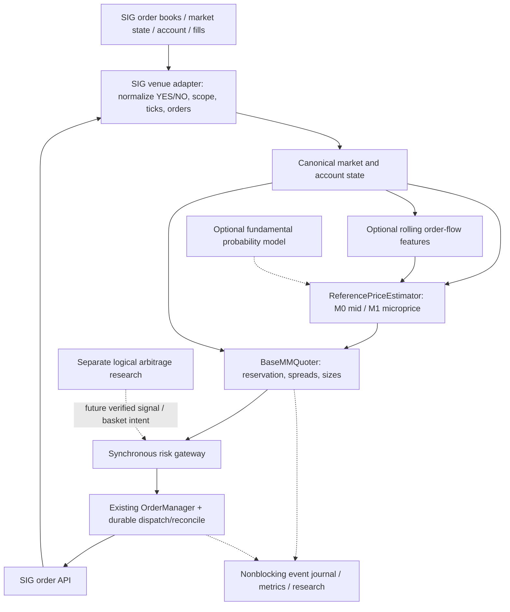

# SIG Predictions: Single-Exchange Market-Making Strategy

> **Status:** Strategy direction and experiment specification — **not** a claim of a working or profitable SIG bot.  
> **Scope:** Market-implied, inventory-aware quoting for a single SIG Exchange at a time; later extend to multiple independent Exchanges.  
> **Architecture:** Reuse the venue-neutral quoter, market-state, risk, order-management and observability components from `market-maker`.  
> **Companion documents:** [SIG data model](./SIG_PREDICTIONS_DATA_MODEL.md) · [Canonical event registry and logical arbitrage workstream](./CANONICAL_EVENT_REGISTRY.md) · [Operations and monitoring](../../../docs/OPERATIONS_MONITORING.md).

## 1. Strategic decision

**Build, verify and benchmark a conventional single-Exchange market-making baseline before making logical arbitrage or fundamental event forecasting part of the trading critical path.**

A SIG **Market** describes the prediction question and settlement; each **Exchange** is a tradable binary payout instrument addressed by `exchangeId`, with YES/NO positions/sides. A *simple* binary Market has one Exchange, and a multi-outcome Market typically contains multiple Exchanges. Even where a Market has a composite MarketNode resolution tree, the quoting/execution problem for an individual Exchange still looks like inventory-managed two-sided market making **provided we know its payout, trading rules and settlement/risk status**.

The initial strategy operates on **one tradable Exchange + one explicit trading context**. It can quote without understanding the natural-language statement or constructing a calibrated fundamental probability model, because it uses **market-implied reference prices**. However, market/settlement metadata remains mandatory for expiry, suspension and event-risk controls. A liquid order book does *not* establish that its midprice is an unbiased probability or that posting around it earns positive expected P&L.

### In scope

- Market discovery and candidate selection for simple, suitable Exchanges.
- YES-normalized market data and fair/reference-price estimates from the current book.
- Inventory skew, dynamic spreads, configurable sizes and quote hysteresis.
- Safe order submission, reconciliation, position/cash tracking, context isolation and observability.
- Offline replay and live-market-data paper testing, followed by controlled tournament trading **only after readiness gates pass**.
- Calibration and side-by-side comparison of progressively more sophisticated quoting policies.

### Not in the first baseline

- Parsing composite MarketNode trees for live quote pricing.
- Canonical event identity matching, Boolean payoff matrices or cross-market arbitrage.
- Per-market LLM interpretation or bespoke fundamental event forecasting.
- Assuming an Avellaneda–Stoikov diffusion/intensity model is calibrated merely because its formula was implemented.
- Optimizing against guessed competition scoring rules.

Keep [the logical-arbitrage research workstream](./CANONICAL_EVENT_REGISTRY.md) separate. It can later supply additional fair-value signals or hedge/basket opportunities through a tested interface; it must never bypass shared execution/risk controls.

## 2. Transferable market-making techniques

| Technique | Reuse from traditional market making | SIG-specific consideration |
| --- | --- | --- |
| Bid/ask spread capture | Post passive quotes around a reference value | YES payoff is bounded 0–1; tick/quote rules are discrete; book may be thin |
| Inventory skew | Lower reservation price when long; raise it when short | Maintain consistent YES-equivalent exposure when fills occur on YES **or** NO |
| Avellaneda–Stoikov (AS) concepts | Reservation price, risk aversion, calibrated fill-intensity model | Binary terminal payoff, jumps and discontinuous settlement invalidate naive diffusion assumptions |
| Order-book microprice | Estimate near-term direction from best-level imbalance | Test predictive power; possible stale, crossed, sparse or one-sided books |
| Order-flow signals | Use recent trades/fills and imbalance | SIG feeds can be batched; event timing and post-fill markouts matter |
| Adaptive spread / size | Wider/smaller during volatility, toxicity and uncertainty | Near-resolution event news and sudden repricing may dominate normal spread income |
| Quote hysteresis | Reduce cancellations and messaging | Respect SIG API limits, unknown outcomes and durable order-state reconciliation |
| Risk and P&L attribution | Apply existing shared execution infrastructure | Unit binary settlement, tournament isolation and YES/NO fill-price conventions |

**Important:** In a binary venue, simultaneously posting a YES bid and a YES ask is one convenient *economic representation*. The adapter must determine how to realize those desired exposures through SIG's `side: yes|no` and `action: buy|sell` order API; these four combinations are not interchangeable wire operations. Do not assume short-selling, cash netting, auto-matching or post-only semantics without venue validation.

## 3. Market and account scope

Use one canonical trading key:

```text
TradingScope = (venue="sig", context_type, tournament_id or "public",
                account_id, exchange_id)
```

All books, last prices, positions, open orders, cash, risk and metrics must use this scope. An `exchangeId` alone is insufficient: public and tournament contexts can have different books, prices, balances, and potentially settlement state.

### Initial market-selection gate

An Exchange is eligible for P0 quoting only if:

1. Its Market is **open** in the selected tournament/context, its exact YES/NO payout and outcome mapping are supported, and it is not already settled.
2. A current **two-sided, internally consistent** YES-normalized book is available, with sufficient depth and reliable timestamps/version state.
3. The quote price range, tick size, size constraints, fees and order semantics have been verified against the SIG API and actual responses.
4. Remaining time to settlement exceeds a configurable minimum *or* an explicit near-expiry policy has been tested.
5. The execution adapter can reconcile orders/fills/balance/positions and determine whether trading is allowed in this account/context.
6. No stale feed, unreconciled order, kill switch or other hard risk stop exists.

Simple Markets are the **preferred** P0 cohort, but not every simple Market is necessarily suitable: liquidity, uncertainty, imminent news and settlement conventions may make it unsafe or uneconomic.

## 4. Price and exposure conventions (critical)

### 4.1 One canonical YES price

For a binary unit-payout claim, let `p` denote the **YES-normalized price** in [0,1].

```text
YES payoff = 1 if event resolves YES, else 0
 NO payoff = 1 - YES payoff
p_NO (theoretical complement) = 1 - p_YES
```

The identity `p_NO = 1-p_YES` describes complementary **payoffs/theoretical values**; separately posted executable bid/ask quotes need **not** sum to 1. The adapter must normalize both YES and NO books/trades without erasing spread or confusing bids with asks.

From the existing [SIG data-model documentation](./SIG_PREDICTIONS_DATA_MODEL.md): Exchange/Market `latestPrice` and realtime price events are described as YES-normalized, whereas REST portfolio `Fill.price` is priced in the **traded side**. Confirm actual payload semantics using fixtures before relying on them. Example of a NO fill at traded-side 0.30 corresponds to YES-normalized price 0.70.

Use `Decimal` in the venue-neutral domain. The SIG adapter owns precise wire conversion, side-aware rounding and discrete price ticks (documented fresh limit price tick: **0.005**, admissible range **0.005–0.995**; recheck on live order validation).

### 4.2 Inventory definition

Define `q` as **YES-equivalent net binary exposure** in shares for one Exchange:

```text
q = economic YES exposure - economic NO exposure
```

Each unit YES exposure has state-dependent payoff `X`; each unit NO exposure has payoff `1-X`. The sign convention is therefore meaningful for reservation-price skew, but **do not use q alone for balance, gross exposure, fees or settlement accounting**: holdings in both outcomes may have different cash and collateral requirements. Track individual outcome quantities, cost basis and cash separately.

For a portfolio holding `n_yes` YES and `n_no` NO claims, with `X in {0,1}`:

```text
terminal_payout = n_yes*X + n_no*(1-X)
                = n_no + (n_yes - n_no)*X
                = n_no + q*X
```

`q` describes the uncertain payoff component only. If the venue supports short positions or sells from inventory, incorporate those explicitly rather than silently assuming unrestricted shorting.

## 5. Baseline pricing and quoting policy

### 5.1 Market-implied reference price

**M0: midpoint baseline**, from a fresh, valid two-sided *YES-normalized executable book*:

```text
s_mid = (best_yes_bid + best_yes_ask) / 2
```

**M1: optional microprice** (hypothesis to backtest, not guaranteed probability):

```text
s_micro = (best_yes_ask * bid_size + best_yes_bid * ask_size)
          / (bid_size + ask_size)
```

Prefer current actionable order-book data; `latestPrice` is an observation, not necessarily a usable current reference, and may be null in a tournament with no trades. Optionally blend mid and microprice by a **calibrated** coefficient, but keep an M0-only control.

Future estimators can add short-horizon order-flow alpha or a fundamental probability estimate using the same `ReferencePriceEstimator` interface. Explicitly log `reference_source`, quality, staleness, and model version.

### 5.2 Reservation price and inventory skew

Start with a clearly labeled heuristic, not a purported exact AS optimum:

```text
r_t = clamp(s_ref,t - kappa_t * q_t, p_min, p_max)
```

- `q_t > 0` (net long YES) moves reservation price **down**: discourage buying more YES and encourage reducing exposure.
- `q_t < 0` moves it **up**.
- `kappa_t` is in price-per-share-of-inventory units, determined empirically and capped by risk limits.
- Evaluate resting and pending orders in potential future exposure; do not skew only using filled inventory while pending bids can fill.

An AS-style expression such as `r = s - q * gamma * sigma^2 * tau` is a *research variant*, not a default for prediction markets. The original derivation assumes a particular diffusion, inventory utility and arrival process. This venue has bounded payoffs, jumps, possible information shocks and often discrete liquidity.

### 5.3 Spread policy

Produce positive offsets `h_bid,t` and `h_ask,t`:

```text
target_yes_bid = r_t - h_bid,t
target_yes_ask = r_t + h_ask,t
```

Initial symmetric control: `h_bid = h_ask = h_min`, where `h_min` is a **configurable calibrated** buffer against fees, adverse selection, stale-book risk and expected execution friction. After collecting data, use asymmetry/size changes driven by short-horizon order flow, inventory and execution toxicity.

Potential spread inputs:

- Observed realized spread and post-fill markouts, *not just quoted spread*.
- Recent order-book volatility and jump frequency; separate continuous repricing from discrete news jumps.
- Quote age, book depth, imbalance, spread and latency.
- Time to scheduled settlement, known announcement windows and market suspension risk.
- Maker/taker fees, rebate rules and actual order routing constraints.

**Conversion rules:** after strategy computation, the SIG adapter maps economic YES bids/asks into valid YES/NO actions and limit prices. Side-aware tick quantization occurs exactly once at the boundary. Enforce no unintended crossing/market taking, non-collapsed spread, allowed price/quantity bounds, and re-run the risk check on the *quantized* order intent.

### 5.4 Quote size, refresh and safety

Start with **one quote per side**, small deterministic sizes, and a strict inventory cap.

- Reduce the risk-increasing quote size as net inventory approaches its configured limit; suppress that quote entirely at the cap.
- Size using **gross outcome exposures, outstanding orders, cash and worst-case fills**, not only net `q`.
- Reprice only when the *quantized* target changes by a calibrated threshold, an order ages beyond a maximum, or a risk condition triggers immediate cancellation.
- Cancel/replace through the shared `OrderManager`; do not simultaneously issue a replacement when a cancel/new acknowledgement is unknown.
- Preserve execution idempotency. A timeout means **unknown**, not automatically rejected or filled.
- Cancel all relevant resting risk when feed/order state is stale, position reconciliation fails, a settlement gate closes, or the configured loss limit trips.

No model-estimated opportunity can bypass the synchronous risk gate.

## 6. Prediction-market-specific risk adjustments

### 6.1 Terminal binary payout

Conditional on a calibrated subjective probability `p`, a unit YES payoff `X` is Bernoulli:

```text
Var(X) = p*(1-p)
Var(q*X) = q^2*p*(1-p)
```

This is a **terminal-payoff risk illustration**, not a calibrated real-time quote-volatility formula. It shows why midprice-return variance alone is insufficient as a proxy for inventory risk, especially near event resolution. Risk policies should distinguish **current mark-to-market risk** from **terminal payout uncertainty** and **liquidity/unwind risk**.

### 6.2 News jumps, expiry and adverse selection

- News can cause abrupt changes in implied probability while stale passive quotes get picked off.
- A market approaching resolution may have high adverse-selection risk even if trailing midprice volatility was quiet.
- Reduce quote size, widen, pause or pull quotes around scheduled resolution/news windows according to a **tested** event-risk policy.
- Stop opening new risk when settlement/close state or data quality cannot be determined.
- Test how SIG handles open orders during suspension, closure and settlement; do not assume outstanding orders cancel automatically.

### 6.3 Multi-outcome and correlated risk

Initially, operate one Exchange independently for valuation, but portfolio risk still needs awareness of related claims. Several Exchanges (within a multi-outcome Market or across markets) may have mutually exclusive, overlapping or dependent payouts. Never assume their risks are independent or prices must sum to 1.

The independent-quoter strategy **must not** imply independent-portfolio-risk limits. Until dependency modeling is verified, use conservative aggregate caps per Market/category/context and account.

## 7. Target architecture and repository integration



**Reuse existing implementations/interfaces where correct; do not add a second order state machine.** Anchors on `main` at the time of writing:

| Area | Existing repository boundary | Proposed SIG-specific work |
| --- | --- | --- |
| Quoting strategy | `quoter/base_quoter.py` defines `BaseMMQuoter` with `fair_price`, `reservation_price`, `calculate_spread`, `calculate_size` | Implement SIG-configured strategy using venue-neutral `Decimal` market/portfolio inputs |
| Book/features | `model/market.py` and market-data handler patterns; `docs/MARKET_DATA_HISTORY_REDIS_DESIGN.md` is a **design proposal**, not evidence that all parts are deployed | Add reliable context-scoped YES-normalized book, feed age/revision and optional in-process rolling features |
| Execution | `execution/order_manager.py` and `execution/safe_gateway.py` | SIG order/side/quantity/tick/idempotency mapping, cancellation reconciliation, durable intents; **confirm compatibility** with venue-specific order IDs and side semantics |
| Risk | `risk/risk_manager.py` and safe gateway | Account/context/exchange caps; settlement/news freezes; per-outcome gross exposure and worst-case outstanding fills |
| Accounting | Existing portfolio domain and reconciliation patterns | Binary payout, YES/NO fill normalization, realized/unrealized and settlement P&L |
| Observability | `docs/OPERATIONS_MONITORING.md`, shared event primitives | Record reference/quotes/inventory/markouts, scoping, model/config versions, reason for abstaining |

The SIG adapter/scored runtime may still require integration work; **a strategy specification is not a live-readiness signoff**.

### Proposed pure strategy interface

```python
def decide_quotes(
    market: MarketSnapshot,        # scoped, validated, YES-normalized
    portfolio: PortfolioSnapshot,  # positions, pending exposure, cash
    features: FeatureSnapshot,     # optional/version aligned
    config: StrategyConfig
) -> QuoteDecision:
    # reference, reservation price, spread, quantities,
    # "no quote" reasons and diagnostic fields
    ...
```

This is an **illustrative interface**, not a claim that those exact classes already exist. Preserve the shared domain types where possible, keep estimation policy configurable, and leave wire conversion to the SIG adapter.

### Minimal decision flow

```text
on_accepted_state_change:
  reconcile market / account / orders / fills
  if unsupported_market or stale_book or unsafe_settlement_window:
      emit no-quote decision; cancel as required; continue reconciling
  s_ref = reference_estimator(book, features)
  r = bounded_inventory_skew(s_ref, filled_and_pending_exposure)
  bid, ask = spread_policy(r, spread_and_risk_features)
  sizes = inventory_and_depth_policy(portfolio, pending_orders)
  intents = SIG_adapter.quantize_and_map(bid, ask, sizes)
  intents = synchronous_risk_gateway.validate(intents)
  OrderManager.reconcile_and_durable_dispatch(intents)
  emit diagnostics including skipped decisions
```

The pseudocode names responsibilities, **not necessarily current call signatures**. An actual integration must preserve the order manager's explicit unknown-outcome and resynchronization invariants.

## 8. Experiments and performance attribution

### Control policies

| Policy | What changes | Research objective |
| --- | --- | --- |
| **M0** | Midpoint reference, constant symmetric spread, fixed small size, strict risk cap | Verify profitable/fair execution is even possible, with a reproducible control |
| **M1** | Add bounded inventory skew only | Quantify reduction in tail inventory exposure versus opportunity cost |
| **M2** | Add microprice / short-horizon order-flow features | Measure predictive markout benefit *out of sample* |
| **M3** | Add empirically calibrated asymmetric spread and size | Improve net risk-adjusted P&L and fill toxicity |
| **M4 (optional)** | Add independently calibrated fundamental event probability | Test whether event modeling beats market-implied baseline |
| **L (separate)** | Add verified logical-arbitrage overlay | Incremental, execution-adjusted P&L from cross-market baskets |

Evaluate variants on the *same market/time cohorts*, with the same venue constraints and execution simulation assumptions. Preserve M0 as the control when tuning more sophisticated policies. Avoid constant sweeping after consistent performance plateaus; move to adaptive/state-conditioned policies only with enough data and out-of-sample validation.

### Required measurements

- **Market making:** quoted spread, realized spread, fill count and side, bid/ask uptime, maker/taker classification, adverse-selection markouts at multiple horizons, per-side fill intensity versus quote distance.
- **Inventory/risk:** signed YES-equivalent `q`, gross YES/NO holdings, cash/collateral, inventory holding time, worst-case binary settlement P&L, loss from event jumps, time spent stopped.
- **Execution quality:** requested versus quantized quotes, cancellations/updates per minute, stale quote age, rejection and timeout rates, delayed fills after cancel requests, reconciliation lag, dropped data/version gaps.
- **Economics:** realized trading P&L, mark-to-market, settled P&L, fees, spread capture versus adverse selection and carry/settlement risk, capital employed; display *before and after costs*.
- **Competition objective:** investigate **actual SIG scoring formula** rather than assuming raw P&L is the only objective; report objective-aligned metrics alongside general strategy quality.
- **Data provenance:** code revision, model/config version, tournament ID, market/exchange ID, book sequence/receive time, reference model, experiment window and seed when stochastic.

**Two primary questions:** (1) Does passive quoting outperform an inactive inventory benchmark after costs? (2) Does each added strategy component improve **out-of-sample net P&L for a comparable risk budget**, rather than just increase volume or gross spread capture?

## 9. Implementation milestones and acceptance gates

| Phase | Deliverable | Acceptance criteria |
| --- | --- | --- |
| **S0 — Read-only SIG diagnostics** | Discover a simple open binary Market and its one Exchange; context-aware market, book and account reads | No cross-context leakage, stable ID/price-side normalization, observed tick and market status rules |
| **S1 — Safe execution plumbing** | SIG intents through shared `OrderManager`, risk gate and durable dispatch; cancel/timeout/fill reconciliation | Duplicate events and timeout tests; no unintended repeated orders; startup and reconnect block until reconciled |
| **S2 — Deterministic M0 quoter** | Pure function with quote validity, bounded size, position/cash limits, max quote age and risk stops | Unit/property tests for prices, YES/NO mapping, inventory and limit cases; dry-run produces explainable decisions |
| **S3 — Paper/live-feed replay** | Record aligned books, quotes, fills and markouts, plus a conservative fill simulator | Repeatable replay; explicit assumptions for queue, fills, latency and data gaps; no leakage from future events |
| **S4 — Controlled tournament entry** | Operator-approved small-risk trading, with monitoring and settlement handling | Observed correct placement/cancel/fill/cash/position reconciliation; known emergency stop; no uncertain open order state |
| **S5 — Incremental model research** | Compare M0/M1/M2/M3 with matched cohorts, cost/risk attribution | OOS evidence of value before promoting any model |
| **S6 — Optional integration** | Fundamental estimator or verified-arbitrage signal through defined interfaces | Independently tested evidence, risk aggregation and no regression to the baseline |

**No automatic live-mode activation.** S0–S3 are legitimate useful deliverables even without funded competition access. Transition to S4 only after documented account/competition rules and end-to-end safety checks.

## 10. Open research questions and early reconnaissance

1. What exactly determines the **competition score**: P&L, risk-adjusted returns, markouts, maker liquidity, trade count or another rule?
2. What proportion of eligible SIG tournament Exchanges have reliable **two-sided depth**, and at what time-of-day/event regimes?
3. Are YES/NO outcome books internally coupled, and which combinations of `side`/`action` are allowed for quoting/reducing positions and at what collateral cost?
4. What are actual maker/taker fees, rebates, rate limits, size bounds, order restrictions and any maker/post-only mechanics in the competition?
5. What level of timestamp precision, sequence information, feed age and reconnect/resync guarantees do market-data endpoints expose?
6. Does microprice/order-flow imbalance predict subsequent price changes or fills after controlling for news, low liquidity and quote staleness?
7. What is the empirical distribution of **news-driven probability jumps**, especially near settlement? Which event categories need an early pause?
8. Can we safely support apparently simple single-exchange Markets whose **settlement payoff mapping** is unusual or ambiguous?
9. How are settlement, cancellation/voiding and post-settlement positions/cash actually reconciled?
10. Can risk be bounded using only per-Exchange inventory, or do we need Market-level/event-cluster caps from day one?
11. How long is the typical queue lifetime and quote persistence, and does passive quoting generate positive **post-fill markouts net of costs**?
12. At what stage does a probabilistic fundamental model or a logical-arbitrage overlay offer better marginal ROI than tuning microstructure and risk?

Track empirical answers with market IDs, timestamped venue data, raw field evidence and explicit uncertainty. Do not present hypothetical model coefficients or expected competition results as measurements.

## 11. Recommendation

**Prioritize the production-quality M0–M1 baseline**: reliable SIG price/position normalization, market-implied reference, inventory-aware quotes, conservative sizes, hysteresis, reconciled execution and transparent P&L attribution.

Treat **M2–M3** as measurable microstructure upgrades; **M4** as optional fundamental pricing research; and **L** as the **independent logical-arbitrage workstream**. The eventual objective is a shared execution/risk foundation supporting both passive market making and verified cross-market relative value, without coupling their research or failure modes.
